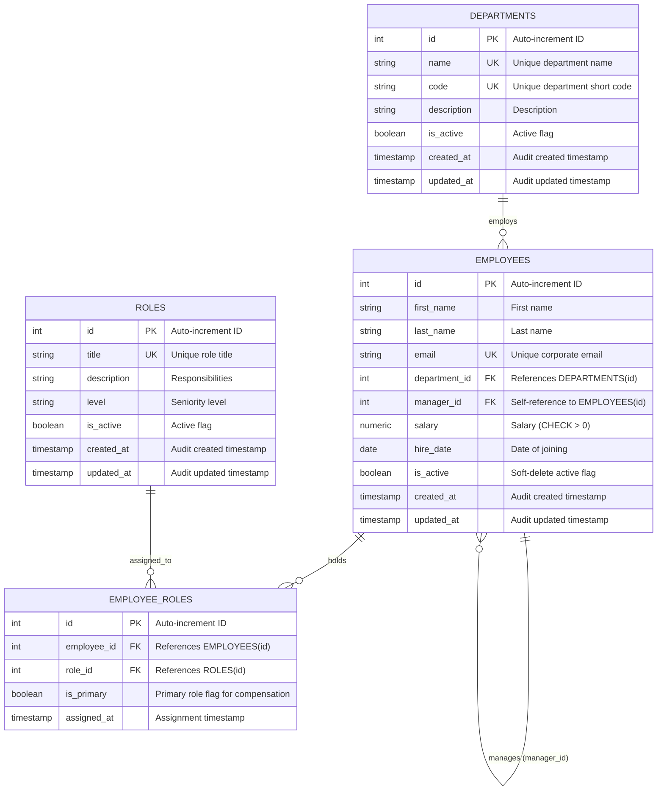

# Aura Workforce OS — Core Payroll, Accounting & Employee Data Engine
### Enterprise Workforce Management & Employee Data Engine (Python)

A production-ready, layered **FastAPI** application skeleton backed by **PostgreSQL** in **Docker Compose**, with environment configuration via `pydantic-settings`, automated testing via `pytest`, and an early team handoff package for Aura Workforce OS.

---

## 🚀 Quickstart (One Command Starts Everything)

Ensure Docker Desktop is installed and running, then execute:

```bash
docker compose up --build
```

That's it! Both the FastAPI application (`api`) and PostgreSQL database (`db`) will start up:
- **API Server:** [http://localhost:8000](http://localhost:8000)
- **Interactive Swagger Docs:** [http://localhost:8000/docs](http://localhost:8000/docs)
- **ReDoc Documentation:** [http://localhost:8000/redoc](http://localhost:8000/redoc)
- **Health Check Endpoint:** [http://localhost:8000/health](http://localhost:8000/health)

To stop the services:
```bash
docker compose down
```

---

## 🏗️ Project Architecture (Layered Design)

This project strictly adheres to a layered design pattern to separate concerns cleanly:

```text
employee_management_api/
├── app/
│   ├── api/                     # Route controllers & routers
│   │   ├── v1/
│   │   │   ├── endpoints/
│   │   │   │   └── health.py    # Health check route handler
│   │   │   └── api.py           # v1 router aggregator
│   ├── core/                    # Core configuration and database session
│   │   ├── config.py            # Pydantic Settings loaded from .env
│   │   └── database.py          # SQLAlchemy engine & session factory
│   ├── models/                  # Database models (Base ready for Task 2)
│   ├── schemas/                 # Pydantic request/response validation schemas
│   │   ├── health.py            # HealthResponse schema
│   │   └── employee.py          # Draft employee contract schemas
│   ├── services/                # Business logic layer
│   │   └── health_service.py    # Health status logic
│   └── main.py                  # FastAPI factory & app instance
├── data/
│   ├── sample_employees.json    # 10 fake employee records (JSON)
│   └── sample_employees.csv     # 10 fake employee records (CSV)
├── docs/
│   ├── api_contract.md          # Comprehensive early API contract
│   └── openapi_draft.json       # Draft OpenAPI 3.1 specification export
├── tests/
│   ├── conftest.py              # TestClient fixture
│   └── test_health.py           # Pytest test for /health
├── .env.example                 # Environment variables template (no secrets)
├── .env                         # Local dev environment configuration
├── .gitignore                   # Standard gitignore (secrets, venv, caches)
├── Dockerfile                   # Python 3.12-slim container image definition
├── docker-compose.yml           # Compose setup for 'api' and 'db' services
├── pyproject.toml               # Modern Python project configuration
├── requirements.txt             # Locked project dependencies
└── README.md                    # Setup and execution guide
```

---

## ⚙️ Environment Variables & Configuration

Settings are managed via `pydantic-settings` in `app/core/config.py`.

- Copy `.env.example` to `.env` if starting fresh:
  ```bash
  cp .env.example .env
  ```
- **Inside Docker Compose**, the database host name is the service name: `db`.
- **Outside Docker** (running locally on host), set `POSTGRES_SERVER=localhost` or point `DATABASE_URL` to your local database.

---

## 🧪 Local Development & Running Tests

### 1. Create and Activate Virtual Environment

```bash
# Windows (PowerShell)
python -m venv .venv
.\.venv\Scripts\Activate.ps1

# Linux / macOS
python3 -m venv .venv
source .venv/bin/activate
```

### 2. Install Dependencies

```bash
pip install -r requirements.txt
```

### 3. Run Database Migrations (Alembic)

```bash
# Inside Docker container:
docker compose exec -T api alembic upgrade head

# Or locally from activated virtual environment:
alembic upgrade head
```

### 4. Run Pytest Suite

```bash
# Inside Docker container:
docker compose exec -T api pytest -v

# Or locally from activated virtual environment:
pytest -v
```

Expected output:
```text
tests/test_health.py::test_top_level_health_endpoint PASSED              [ 11%]
tests/test_health.py::test_api_v1_health_endpoint PASSED                 [ 22%]
tests/test_models.py::test_unique_email_constraint PASSED                [ 33%]
tests/test_models.py::test_salary_check_constraint PASSED                [ 44%]
tests/test_models.py::test_manager_hierarchy_relationship PASSED         [ 55%]
tests/test_models.py::test_department_foreign_key_and_relationship PASSED [ 66%]
tests/test_models.py::test_multiple_roles_and_unique_assignment PASSED   [ 77%]
tests/test_models.py::test_soft_delete_preservation PASSED               [ 88%]
tests/test_models.py::test_unique_department_and_role_constraints PASSED [100%]
============================== 9 passed in 1.12s ===============================
```

### 5. Run API Server Locally (Without Docker)

```bash
uvicorn app.main:app --reload --port 8000
```

---

## 🏛️ Task 2: Employee, Department & Role Data Model

### 1. Entity Relationship (ER) Diagram



Detailed ER specifications are documented in [`docs/er_diagram.md`](docs/er_diagram.md).

### 2. Architectural Design Decision: One Role vs. Many Roles

**Decision:** Employees can hold **multiple roles** via the `employee_roles` association model, designating one as primary via `is_primary: bool`.

**Rationale:**
1. **Real-world Organizational Needs:** In modern tech and workforce organizations, an employee always holds a primary job designation (e.g. *Senior Software Engineer*) tied to compensation and salary bands, but often carries secondary operational or governance responsibilities (e.g. *Incident Commander*, *Hiring Bar Raiser*, *Team Lead*, *Data Protection Officer*).
2. **Future-Proofing Schema:** Storing roles in a junction table (`employee_roles`) prevents future breaking schema migrations when permissions, access tiers, or secondary responsibilities are added.
3. **Dual Compatibility:** Queries needing the primary position simply filter `is_primary == True`, while audits and access controls query all assigned roles.

### 3. Manager Hierarchy & Self-Referential Relationship
- `manager_id` points to `employees.id` (`ondelete="SET NULL"`).
- Top executives have `manager_id = NULL`.
- Traversal supported in both directions:
  - `employee.manager`: Fetches the manager.
  - `employee.direct_reports`: Returns all team members reporting to this manager.

### 4. Constraints & Search Indexes
- **Email Uniqueness:** `UNIQUE (email)` prevents duplicate employee records.
- **Positive Compensation:** `CHECK (salary > 0)` rejects negative or zero salaries.
- **Search Indexes:**
  - `ix_employees_name`: Composite index on `(last_name, first_name)` for fast roster lookup.
  - `ix_employees_dept_active`: Composite index on `(department_id, is_active)` for active department employee listings.
  - `ix_employees_email`, `ix_employees_manager_id`: Fast direct query indexing.

### 5. Alembic Database Migrations
Migrations are fully scripted and version-controlled under `alembic/versions/`:
- **Upgrade to latest schema:** `docker compose exec -T api alembic upgrade head`
- **Rollback to clean state:** `docker compose exec -T api alembic downgrade base`

---

## 📦 Early Handoff Package (Shared by Day 2)

As required for cross-team alignment:
1. **Draft API Contract:**
   - Table and endpoint specifications: [`docs/api_contract.md`](docs/api_contract.md)
   - Machine-readable OpenAPI 3.1 schema: [`docs/openapi_draft.json`](docs/openapi_draft.json)
2. **Sample Fake-Data (10 Employees):**
   - JSON format: [`data/sample_employees.json`](data/sample_employees.json)
   - CSV format: [`data/sample_employees.csv`](data/sample_employees.csv)

---

## ⚡ Task 3: Employee & Team APIs

### 1. Endpoints Overview

All endpoints are mounted under `/api/v1/` with top-level aliases (`/employees`, `/departments`):

| Method | Endpoint | Description | Status Code | Query / Body Params |
|---|---|---|---|---|
| `POST` | `/api/v1/employees` | Create a new employee with department & primary role | `201 Created` | JSON body (`EmployeeCreate`) |
| `GET` | `/api/v1/employees` | List active employees with pagination & search | `200 OK` | `?page=1&size=20&department=ENG&q=Smith` |
| `GET` | `/api/v1/employees/{id}` | Get detailed employee profile by ID | `200 OK` | Path `id` |
| `PATCH`| `/api/v1/employees/{id}` | Partial update (first/last name, salary, manager, etc.) | `200 OK` | Path `id`, JSON body (`EmployeeUpdate`) |
| `DELETE`| `/api/v1/employees/{id}` | Soft delete employee (sets `is_active=False`) | `204 No Content`| Path `id` |
| `GET` | `/api/v1/employees/{id}/team` | Get manager and their direct reports | `200 OK` | Path `id` |
| `GET` | `/api/v1/departments` | List all departments with active headcounts | `200 OK` | — |
| `GET` | `/api/v1/departments/{id}` | Get single department with active headcount | `200 OK` | Path `id` |
| `GET` | `/api/v1/departments/{id}/employees` | Get paginated employees in a department | `200 OK` | Path `id`, `?page=1&size=20` |

### 2. Service Layer Separation (Zero Business Logic in Routes)

Routes act strictly as lean HTTP controllers:
- **`app/services/employee_service.py`**: Handles employee validation, cycle detection (e.g. self-manager prevention), database transactions, soft-deletion, search filtering, and pagination math.
- **`app/services/department_service.py`**: Handles department retrieval, active headcount aggregation, and department roster pagination.
- **`app/schemas/`**: Pydantic schemas enforce strict contract isolation between input (`EmployeeCreate`, `EmployeeUpdate`) and output (`EmployeeResponse`, `DepartmentResponse`, `PaginatedResponse`).

### 3. Validations & Rules
- **Email Validation**: Valid RFC-compliant email address with unique constraint checking.
- **Hire Date Validation**: Joining date is prohibited from being in the future (`hire_date <= date.today()`).
- **Name Validation**: First and last names must be non-empty strings with whitespace stripped.
- **Soft Delete**: `DELETE /employees/{id}` sets `is_active = False` to preserve payroll and historical audit trails. Soft-deleted records are automatically excluded from directory rosters unless explicitly requested.
- **Manager Validation**: Self-assignment as one's own manager is prevented with a 400 Bad Request error.

### 4. Unified Error Format
All application errors, HTTP exceptions, and request validation errors return a consistent JSON envelope:
```json
{
  "detail": "Employee with ID 99999 not found",
  "error_code": "NOT_FOUND",
  "field": "employee_id"
}
```

### 5. Automated Test Suite (25 Tests)
The comprehensive test suite in `tests/` covers:
- CRUD lifecycles for employees and departments
- Pagination math (`total`, `page`, `size`, `pages`)
- Combined search (`q`) and department filtering
- Bad inputs: future hire dates, empty/blank names, non-existent department foreign keys, duplicate emails, self-manager cycles
- Soft-delete roster filtering and retrieval

Run tests anytime:
```bash
# In Docker:
docker compose exec -T api pytest -v

# Locally on host:
pytest -v
```

---

## 📊 Task 4: Master Dataset, Seed Pipeline & Early Exports

### 1. Objective & Domain Importance
All six domains (Payroll, AI/ML, Accounting, Time & Attendance, Reporting, and Core Workforce) depend on this master dataset. It establishes the single source of truth for employee records, organizational reporting hierarchy, historical salary compensation revisions, and linked daily attendance.

### 2. Dataset Sourcing & Master Excel Specification
- **Master Dataset File**: [`data/01_LedgerForge_Python_Master_Dataset.xlsx`](data/01_LedgerForge_Python_Master_Dataset.xlsx)
- **Source Context**: The enterprise master dataset containing 11 departments (`D00`–`D10`), 58 normalized job roles (`R001`–`R058`), 745 employees (`EMP-0001`–`EMP-0745`), full historical salary revisions and payroll items, and over 150,000 attendance records.

### 3. Data Cleaning & Enrichment Pipeline (`scripts/data_pipeline.py`)
The pipeline loads and cleans the master dataset using `pandas` and `Faker`:
1. **Pandas Data Cleaning & Extraction**:
   - Parses the master Excel workbook sheets (`departments`, `roles`, `employees`, `salary_revisions`, `payroll_items`, `attendance`).
   - Standardizes employee codes, date timestamps (`hire_date`, `exit_date`), and maps employment status (`Active` vs `Resigned/Terminated` -> `is_active`).
   - Cleans and rebrands all corporate email addresses to Aura Workforce OS domain: `@auraworkforce.io` (e.g., `first.last@auraworkforce.io`).
2. **Deterministic Faker Enrichment (`seed=42`)**:
   - Fixed seeds (`Faker.seed(42)`, `random.seed(42)`, `np.random.seed(42)`) ensure exact repeatability across runs.
   - Enriches every employee record with realistic corporate mobile phone numbers.
   - Strictly zero `"test123"` placeholder data.
3. **Relational Linkage**:
   - **Departments & Roles**: 11 departments (`D00`–`D10`) and 58 roles mapped across all 745 employees.
   - **Organizational Hierarchy**: Multi-tier acyclic tree rooted in Executive Leadership (`Tejas Chowdhury`, CEO, `EMP-0006`).
   - **Salary Compensation**: Base annual fixed salaries from `salary_revisions` + 3,781 monthly salary records from `payroll_items` (basic, allowances, bonuses, deductions, net pay).
   - **Attendance Tracking**: 36,751 linked daily attendance records covering recent work periods (`PRESENT`, `REMOTE`, `ON_LEAVE`, `HALF_DAY`, `ABSENT`) with check-in/out timestamps and work hours.

### 4. One-Command Seeding Pipeline (`scripts/seed.py`)
Run the pipeline to populate a clean or existing database in a single command:

```bash
# In Docker or local environment:
python -m scripts.seed

# Or via Makefile:
make seed
```

#### Safe Repeatable Seeding (Idempotency)
- **Duplicate Prevention**: Running `python -m scripts.seed` multiple times safely updates or skips existing rows using unique constraints on `email`, `employee_code`, `(employee_id, pay_period)`, and `(employee_id, date)`.
- Re-running the command produces **0 duplicate records**.
- To execute a completely clean reseed from scratch:
  ```bash
  python -m scripts.seed --reset
  # Or:
  make seed-reset
  ```

### 5. CSV Exports Package (`data/exports/`)
The seeder automatically generates standard UTF-8 CSV exports for cross-functional domain teams, also runnable on-demand via:
```bash
python -m scripts.export_csv
# Or:
make export
```

| Export File | Description | Records |
|---|---|---|
| [`data/exports/employees.csv`](data/exports/employees.csv) | Full 745 employee roster with department, role, manager, compensation, and contact info | 745 |
| [`data/exports/salaries.csv`](data/exports/salaries.csv) | Linked monthly salary breakdowns, base, allowances, bonuses, deductions, and net pay | 3,781 |
| [`data/exports/attendance.csv`](data/exports/attendance.csv) | Linked daily attendance logs, work hours, and remote/shift notes | 36,751 |

---

## 🔗 Connection to Next Task (Task 5)

With believable, linked employees and organizational reporting hierarchies seeded, **Task 5 (Authentication & Role-Based Access Control)** will secure all APIs with authentication tokens and permission scopes, enforcing department and role-level visibility rules.


