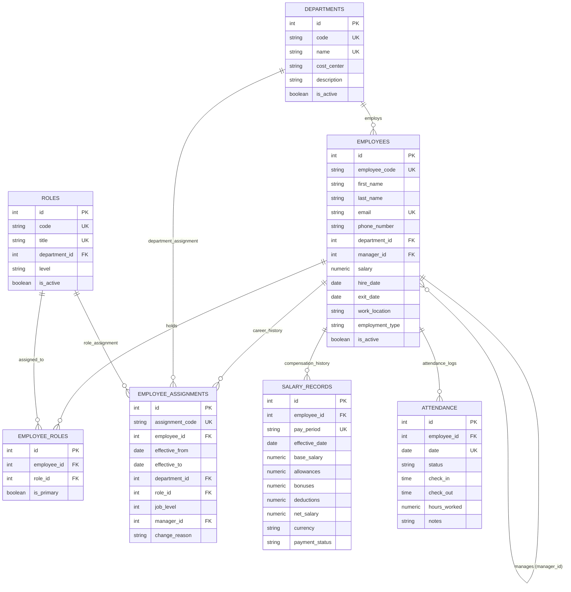

# Aura Workforce OS — Core Payroll, Accounting & Employee Data Engine
### Enterprise Workforce Management & Employee Data Engine (Python)

**GitHub Repository:** https://github.com/abhinav2231/employee-management-api-

A production-ready, layered **FastAPI** application backed by **PostgreSQL** in **Docker Compose**, with environment configuration via `pydantic-settings`, automated testing via `pytest`, and an early team handoff package for Aura Workforce OS.

---

## 🚀 Quickstart (One Command Starts Everything)

Ensure Docker Desktop is installed and running, then execute:

```bash
docker compose up --build -d
```

Both the PostgreSQL database (`db`) and FastAPI application (`api`) will start up:
- Database migrations (`alembic upgrade head`) execute automatically before the API accepts traffic.
- **API Server:** [http://localhost:8000](http://localhost:8000)
- **Interactive Swagger Docs:** [http://localhost:8000/docs](http://localhost:8000/docs)
- **ReDoc Documentation:** [http://localhost:8000/redoc](http://localhost:8000/redoc)
- **Health Check Endpoint:** [http://localhost:8000/health](http://localhost:8000/health)

To seed the initial master dataset:
```bash
docker compose exec api python -m scripts.seed
```

To stop the services:
```bash
docker compose down
```

---

## 🏗️ Project Architecture (Layered Design)

This project strictly adheres to a layered design pattern to separate concerns cleanly:

```text
employee_management_api/
├── app/
│   ├── api/                     # Route controllers & routers
│   │   ├── v1/
│   │   │   ├── endpoints/
│   │   │   │   ├── health.py    # Health check route handler
│   │   │   │   ├── employees.py # Employee CRUD, search, filter & team routes
│   │   │   │   └── departments.py # Department listing and headcount routes
│   │   │   └── api.py           # v1 router aggregator
│   ├── core/                    # Core configuration and database session
│   │   ├── config.py            # Pydantic Settings loaded from .env
│   │   ├── database.py          # SQLAlchemy engine & session factory
│   │   └── exceptions.py        # Centralized error envelopes & handlers
│   ├── models/                  # SQLAlchemy ORM models
│   │   ├── base.py              # Base and TimestampMixin
│   │   ├── department.py        # Department entity
│   │   ├── role.py              # Role & EmployeeRole entities
│   │   ├── employee.py          # Employee entity with manager self-reference
│   │   ├── assignment.py        # EmployeeAssignment career history
│   │   ├── salary.py            # SalaryRecord compensation history
│   │   └── attendance.py        # Attendance tracking
│   ├── schemas/                 # Pydantic request/response validation schemas
│   │   ├── common.py            # PaginatedResponse envelope
│   │   ├── health.py            # HealthResponse schema
│   │   ├── department.py        # Department schemas
│   │   ├── role.py              # Role schemas
│   │   └── employee.py          # Employee CRUD schemas
│   ├── services/                # Business logic layer
│   │   ├── health_service.py    # Health status logic
│   │   ├── department_service.py# Department business operations & aggregation
│   │   └── employee_service.py  # Employee operations, cycle detection, validations
│   └── main.py                  # FastAPI factory & app instance
├── data/
│   ├── 01_LedgerForge_Python_Master_Dataset.xlsx # Master dataset
│   └── exports/                 # Clean CSV exports
│       ├── employees.csv        # 745 employee records
│       ├── salaries.csv         # 3,781 salary records
│       └── attendance.csv       # 36,751 attendance records
├── docs/
│   ├── api_contract.md          # Comprehensive early API contract
│   ├── er_diagram.md            # Data model and architectural decisions
│   └── openapi_draft.json       # OpenAPI 3.1 specification export
├── scripts/
│   ├── entrypoint.sh            # Container startup script (runs alembic upgrade head)
│   ├── data_pipeline.py         # Dataset extraction & pandas cleaning
│   ├── seed.py                  # Master idempotent database seeder
│   ├── export_csv.py            # Portable CSV export utility
│   └── view_data.py             # CLI database visualizer
├── tests/
│   ├── conftest.py              # Isolated test database runner (aura_workforce_test_db)
│   ├── test_health.py           # Health endpoint tests
│   ├── test_models.py           # Check constraints & relationship tests
│   ├── test_api_departments.py  # Department endpoint tests
│   ├── test_api_employees.py    # Employee CRUD, cycle prevention & patch tests
│   └── test_seed_pipeline.py    # Seeding, idempotency, Faker repeatability tests
├── .env.example                 # Environment variables template (no secrets committed)
├── .gitignore                   # Standard gitignore (secrets, venv, caches)
├── Dockerfile                   # Python 3.12-slim container image definition
├── docker-compose.yml           # Compose setup for 'api' and 'db' services
├── pyproject.toml               # Modern Python project configuration
├── requirements.txt             # Locked project dependencies
└── README.md                    # Setup and execution guide
```

---

## 🗄️ Database Architecture & ER Diagram



### Architectural Decisions
1. **One-to-Many vs Multi-Role**: Employees hold multiple roles via `employee_roles` with an `is_primary` flag, allowing secondary duties without breaking schema migrations.
2. **Organizational Hierarchy & Cycle Prevention**: Self-referential `manager_id` foreign key with acyclic hierarchy validation. Both direct self-management and multi-hop circular reporting (A → B → A, A → B → C → A) are prevented.
3. **Soft Deletes**: Soft deletion sets `is_active = False`. When a manager is soft-deleted, their direct reports are automatically reassigned to the manager's manager to eliminate dangling hierarchy nodes.
4. **Isolated Test Execution**: Pytest runs against an isolated test database (`aura_workforce_test_db`), ensuring testing never alters or wipes the development master dataset.

---

## 🧪 Running Tests & Verifying System

### Running Tests Locally

```bash
# Run full automated test suite (33 tests)
pytest -v
```

All 33 tests execute against the isolated test database:
```text
======================= 33 passed in 149.22s =======================
```

### Proving End-to-End Operation (Docker)

```bash
# 1. Start containers (applies migrations automatically)
docker compose up --build -d

# 2. Check health endpoint
curl http://localhost:8000/health
# Output: {"status":"ok"}

# 3. Test migration rollbacks and re-application
docker compose exec api alembic downgrade base
docker compose exec api alembic upgrade head
docker compose exec api alembic check

# 4. Run master dataset seeder
docker compose exec api python -m scripts.seed

# 5. Verify idempotent seeding (row counts remain unchanged)
docker compose exec api python -m scripts.seed

# 6. Run automated test suite
docker compose exec api pytest -v
```

---

## 📊 Dataset Provenance & Clean Exports

- **Source File:** [`data/01_LedgerForge_Python_Master_Dataset.xlsx`](data/01_LedgerForge_Python_Master_Dataset.xlsx)
- **Provenance & License:** Enterprise benchmark workforce and payroll data distributed under the **Creative Commons Attribution 4.0 International (CC BY 4.0)**.
- **Enrichment & Standardization:**
  - Names, departments, roles, compensation records, and attendance histories originate from the master dataset.
  - Work emails are standardized to `@auraworkforce.io`.
  - Phone numbers are generated deterministically using `Faker("en_IN", seed=42)` for realistic Indian corporate numbers.
- **Standardized CSV Exports in [`data/exports/`](data/exports/):**
  - [`employees.csv`](data/exports/employees.csv): Exactly 745 employee records with `employee_code`, `department_code`, `role_title`, and `manager_code`.
  - [`salaries.csv`](data/exports/salaries.csv): 3,781 monthly payroll breakdowns with `employee_code`.
  - [`attendance.csv`](data/exports/attendance.csv): 36,751 attendance records with `employee_code`.

---

## 🔗 Connection to Next Task (Task 5)

With robust CRUD APIs, acyclic manager hierarchy enforcement, isolated testing, and clean master dataset seeding established, **Task 5 (Authentication & Role-Based Access Control)** will introduce JWT authentication tokens and permission scopes.
