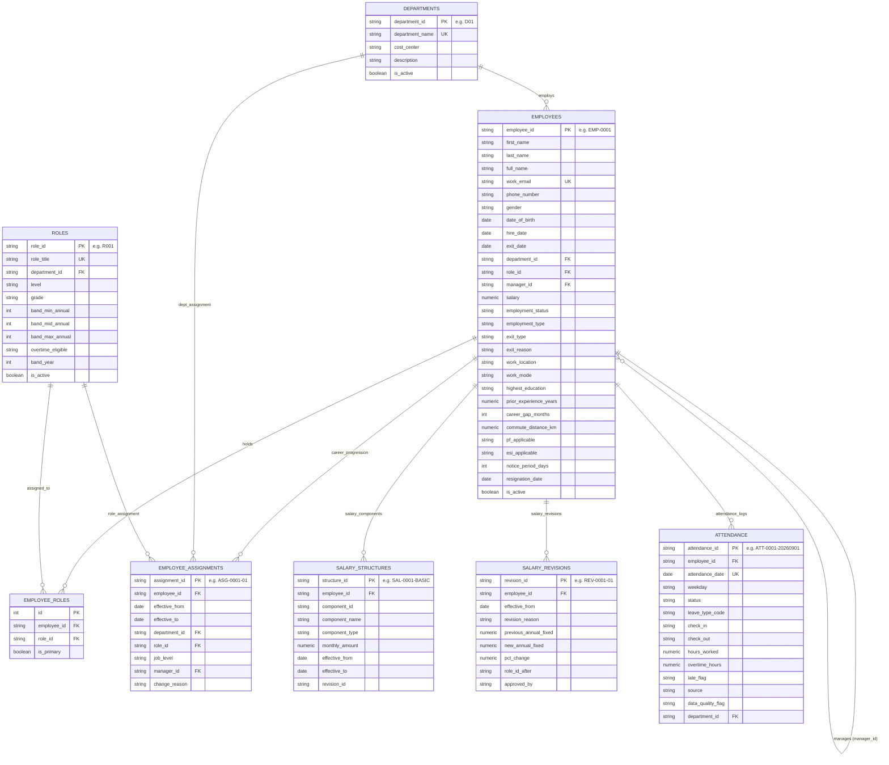

# Aura Workforce OS — Core Payroll, Accounting & Employee Data Engine
### Enterprise Workforce Management & Employee Data Engine (Python)

**GitHub Repository:** https://github.com/abhinav2231/employee-management-api-  
**Git Handoff Tag:** `handoff-day2`

A production-ready, layered **FastAPI** application backed by **PostgreSQL** in **Docker Compose**, with environment configuration via `pydantic-settings`, automated testing via `pytest` (78 tests passing), and an early team handoff package for Aura Workforce OS.

---

## 📦 Handoff Package (Day 2 Deliverables for Other Teams)

To enable client, web, and backend teams to build concurrently before all 20 roadmap tasks are finished, this repository delivers an early handoff package:

1. **Draft API Contracts:**
   - [`docs/openapi_draft.json`](docs/openapi_draft.json): Maintained **OpenAPI 3.1.0 specification** detailing **64 operations across 49 distinct paths**, spanning all 20 roadmap tasks (Core Workforce, Auth/RBAC, Payroll/Compliance, Attendance/Leaves, and Analytics/Reporting).
   - [`docs/api-contract.md`](docs/api-contract.md): Human-readable Markdown contract with endpoint tables, query filters, sort syntax (`sort=field|-field`), natural primary keys, standard error envelopes, and privacy access policies.
2. **Realistic Sample Dataset:**
   - [`data/sample_employees.json`](data/sample_employees.json): 10 realistic employee records formatted according to the updated schema with natural text keys and full workbook attributes.
   - [`data/sample_employees.csv`](data/sample_employees.csv): CSV representation of the sample data for spreadsheet and ingestion tools.
3. **Clean Standardized Dataset Exports (in [`exports/`](exports/)):**
   - [`employees.csv`](exports/employees.csv): All 745 employees with all 27 sheet attributes and natural keys (`EMP-XXXX`).
   - [`salary_structures.csv`](exports/salary_structures.csv): 12,295 salary component breakdown records.
   - [`attendance.csv`](exports/attendance.csv): All 150,155 attendance records across the full 18-month history (`2025-04-01` to `2026-09-30`).
   - [`salary_revisions.csv`](exports/salary_revisions.csv): 2,459 historical compensation adjustments.
   - [`assignments.csv`](exports/assignments.csv): 1,606 career progression records.
4. **Authoritative Calculation Answer Key:**
   - [`tests/fixtures/payroll_items_expected.json`](tests/fixtures/payroll_items_expected.json): 7,340 payroll calculation benchmark records exported from the workbook's `payroll_items` sheet, serving as the test fixture answer key for subsequent payroll engine tasks.
5. **Verified Test Suite:**
   - **78 tests passing** (`pytest -v`), verifying health checks, production secret guards, database constraints, cycle prevention, reparenting on deactivation, idempotent seeding, and data export integrity.

---

## 🚀 Quickstart (One Command Starts Everything)

Ensure Docker Desktop is installed and running, then execute:

```bash
# 1. (Optional) Customize environment variables from the template:
cp .env.example .env

# 2. Build and launch database and API containers:
docker compose up --build -d
```

> **Note on `.env`:** The `docker-compose.yml` configures `required: false` for `.env` (requires Docker Compose v2.24+; for older Compose versions, simply run `cp .env.example .env`). All necessary configuration defaults are pre-baked, allowing a fresh clone to start up immediately without requiring manual `.env` file creation.

Both the PostgreSQL database (`db`) and FastAPI application (`api`) will start up:
- Database migrations (`alembic upgrade head`) execute automatically via `entrypoint.sh` before the API accepts traffic.
- Test database (`aura_workforce_test_db`) is automatically provisioned via Postgres init scripts and test fixtures.
- **API Server:** [http://localhost:8000](http://localhost:8000)
- **Interactive Swagger Docs:** [http://localhost:8000/docs](http://localhost:8000/docs)
- **ReDoc Documentation:** [http://localhost:8000/redoc](http://localhost:8000/redoc)
- **Health Check Endpoint:** [http://localhost:8000/health](http://localhost:8000/health)

To seed the initial master dataset:
```bash
docker compose exec api python -m scripts.seed
```

To run the automated test suite in Docker:
```bash
docker compose exec api pytest -v
```

To stop the services:
```bash
docker compose down
```

---

## 🏗️ Project Architecture (Layered Design)

This project strictly adheres to a layered design pattern to separate concerns cleanly:

```text
employee_management_api/
├── app/
│   ├── api/                     # Route controllers & routers
│   │   ├── v1/
│   │   │   ├── endpoints/
│   │   │   │   ├── health.py    # Health check route handler (/health, /api/v1/health, /health/ready)
│   │   │   │   ├── employees.py # Employee CRUD, multi-column search, filter, sorting, team & assignments routes
│   │   │   │   ├── departments.py # Department full CRUD and roster routes
│   │   │   │   └── roles.py     # Role listing and detail route handlers
│   │   │   └── api.py           # v1 router aggregator
│   ├── core/                    # Core configuration and database session
│   │   ├── config.py            # Pydantic Settings loaded from .env (ENV, JWT, DEMO_TODAY, SEED_ON_START)
│   │   ├── database.py          # SQLAlchemy engine & session factory
│   │   └── exceptions.py        # Centralized error envelopes & request_id tracing
│   ├── models/                  # SQLAlchemy ORM models (natural text keys)
│   │   ├── base.py              # Base and TimestampMixin
│   │   ├── department.py        # Department entity (department_id: D00..D10)
│   │   ├── role.py              # Role (R001..R058) & EmployeeRole backward compatibility
│   │   ├── employee.py          # Employee entity with 27 sheet columns & natural key EMP-XXXX
│   │   ├── assignment.py        # EmployeeAssignment career progression (ASG-XXXX-XX)
│   │   ├── salary_structure.py  # SalaryStructure component breakdown (SAL-XXXX-...)
│   │   ├── salary_revision.py   # SalaryRevision compensation history (REV-XXXX-XX)
│   │   └── attendance.py        # Attendance tracking with 150k logs across 18 months
│   ├── schemas/                 # Pydantic request/response validation schemas
│   │   ├── common.py            # PaginatedResponse envelope
│   │   ├── health.py            # HealthResponse & HealthDetail schemas
│   │   ├── department.py        # Department schemas
│   │   ├── role.py              # Role schemas
│   │   ├── assignment.py        # EmployeeAssignment schemas
│   │   └── employee.py          # Employee CRUD schemas & validation
│   ├── services/                # Business logic layer
│   │   ├── health_service.py    # Health status & database ping checks
│   │   ├── department_service.py# Department operations & headcount aggregation
│   │   ├── employee_service.py  # Employee CRUD, cycle prevention, inactive manager checks, assignment history
│   │   └── role_service.py      # Role listing and lookup queries
│   └── main.py                  # FastAPI factory & app instance
├── data/
│   ├── seed/
│   │   └── 01_LedgerForge_Python_Master_Dataset.xlsx # Master dataset workbook
│   ├── sample_employees.json    # 10 realistic employee sample records (natural keys)
│   └── sample_employees.csv     # Sample CSV representation
├── docs/
│   ├── api-contract.md          # Comprehensive multi-phase API contract
│   ├── er_diagram.md            # Mermaid ER diagram & architectural decisions
│   └── openapi_draft.json       # OpenAPI 3.1.0 specification draft (64 operations)
├── exports/                     # Clean standardized CSV data exports
│   ├── employees.csv            # 745 employee records
│   ├── salary_structures.csv    # 12,295 component breakdown records
│   ├── attendance.csv           # 150,155 attendance logs
│   ├── salary_revisions.csv     # 2,459 compensation adjustments
│   └── assignments.csv          # 1,606 career progression records
├── reports/
│   └── phase-1-review.md        # Phase 1 milestone review summary
├── scripts/
│   ├── entrypoint.sh            # Container startup script (runs alembic upgrade head)
│   ├── data_pipeline.py         # Workbook extraction, cleaning & fixture export
│   ├── seed.py                  # Idempotent database seeder (supports reset & --extra-50)
│   ├── extra_fake.py            # Generator for 50 synthetic employees (Faker seed 2026)
│   ├── export_csv.py            # Database-to-CSV export utility
│   ├── generate_openapi.py      # OpenAPI 3.1.0 specification generator
│   ├── init_test_db.sql         # Postgres auto-init script for aura_workforce_test_db
│   └── view_data.py             # CLI database overview utility
├── tests/
│   ├── conftest.py              # Auto-provisioning test database runner (aura_workforce_test_db)
│   ├── fixtures/
│   │   └── payroll_items_expected.json # 7,340 expected calculation benchmark records
│   ├── test_health.py           # Health endpoint tests & production secret guards
│   ├── test_models.py           # Check constraints & relationship tests
│   ├── test_api_departments.py  # Department endpoint tests
│   ├── test_api_employees.py    # Employee CRUD, cycle prevention, reparenting & assignments
│   └── test_seed_pipeline.py    # Master dataset extraction, 150k attendance & CSV export tests
├── .env.example                 # Environment variables template (no secrets committed)
├── .gitattributes               # LF line endings enforcement for Docker portability
├── .gitignore                   # Standard gitignore (secrets, venv, caches)
├── Dockerfile                   # Python 3.12-slim container image definition
├── docker-compose.yml           # Compose setup with optional .env & test DB auto-init
├── pyproject.toml               # Modern Python project configuration
├── requirements.txt             # Project runtime dependencies (version ranges)
├── requirements-dev.txt         # Development and testing dependencies (pytest, httpx)
└── README.md                    # Setup and execution guide
```

---

## 🗄️ Database Architecture & ER Diagram



---

## 📋 Assumptions & Architectural Decisions

1. **Natural String Primary Keys:**
   All primary keys match the natural text keys established in the workbook (`EMP-0001`..`EMP-0745`, `D00`..`D10`, `R001`..`R058`, `ASG-...`, `REV-...`, `SAL-...`, `ATT-...`). SQLAlchemy `@hybrid_property` attributes (`.id`, `.code`, `.email`, `.name`) preserve transparent backward compatibility for legacy queries.
2. **Single Primary Role with Progression History:**
   In alignment with the master dataset structure, each employee has a single current role designation on `employees.role_id`. All promotions, department transfers, and job level changes are recorded in `employee_assignments`. The `employee_roles` table is retained as a compatibility junction.
3. **Preservation of Authentic Email Addresses:**
   Workbook emails (`@znova-demo.example`) are preserved intact so that usernames match the `users` sheet for Task 5's authentication and RBAC workflows.
4. **Historical Scope & Cut-Off Date (`DEMO_TODAY = 2026-09-30`):**
   The dataset represents 18 months of corporate history (`2025-04-01` to `2026-09-30`). The system benchmark date is pinned to `2026-09-30`. Any hire date past this date is rejected as future-dated. All **150,155 attendance records** across all 18 months are ingested via batched bulk insertion.
5. **Separation of Operational Data vs Test Calculation Key:**
   The `payroll_items` sheet (7,340 records) represents calculated outputs from historical monthly payroll runs. In Tasks 1–4, this is exported to `tests/fixtures/payroll_items_expected.json` as an immutable answer key to benchmark future calculation logic in Task 9, rather than being stored as an unlinked operational table.
6. **Monetary Precision:**
   All monetary fields (`salary`, `previous_annual_fixed`, `new_annual_fixed`, `monthly_amount`) use `Numeric(14, 2)` to eliminate binary floating-point rounding errors.
7. **Unified Reparenting on Deactivation:**
   When an employee is deactivated (via `DELETE /api/v1/employees/{id}` or `PATCH` with `is_active=false` / `employment_status="Resigned"`), direct reports are automatically re-assigned to the manager's manager, preventing broken hierarchy links. Assigning an inactive manager is rejected with HTTP 400.
8. **Cycle Prevention:**
   Acyclic reporting validation prevents self-reporting and circular chains of any depth (A → B → A, A → B → C → A).
9. **Unified Error Envelope:**
   All exceptions return `{"error": {"code": "...", "message": "...", "details": [...], "request_id": "..."}}` while preserving top-level `detail`, `error_code`, and `field` attributes for backward compatibility.
10. **Dual Health Probes:**
    - `GET /health`: Ultra-lightweight endpoint returning `{"status": "ok"}` for container orchestrators and load balancers.
    - `GET /api/v1/health`: Detailed diagnostic metadata returning `status`, `service`, `version`, and live database check results.
    - `GET /health/ready`: Database connectivity check returning 503 if unreachable.

---

## 🧪 Verification & Automated Testing

The complete test suite runs via `pytest`:

```bash
docker compose exec api pytest -v
# or locally in virtual environment:
pytest -v
```

**Results:**
```text
78 passed, 1 warning in 195.88s (0:03:15)
```

Covering:
- **`tests/test_api_departments.py`** (17 tests): Full department CRUD, headcount aggregation, unique code/name validation, roster pagination, and deletion safety.
- **`tests/test_api_employees.py`** (43 tests): Employee CRUD, cycle prevention, inactive manager validation, multi-column search/filtering, sorting (`sort=field|-field`), assignments endpoint, and reparenting on deactivation.
- **`tests/test_health.py`** (3 tests): Liveness, detailed diagnostic health, and production secret key safety checks.
- **`tests/test_models.py`** (9 tests): Check constraints, foreign keys, hybrid properties, unique constraints, and soft delete preservation.
- **`tests/test_seed_pipeline.py`** (6 tests): Master dataset extraction, Faker repeatability, 150k attendance ingestion, idempotent re-seeding, and CSV export integrity.

---

## 📊 Dataset Provenance & Clean Exports

- **Source File:** [`data/seed/01_LedgerForge_Python_Master_Dataset.xlsx`](data/seed/01_LedgerForge_Python_Master_Dataset.xlsx)
- **Scope Notice:** This pipeline implements the **Core HR & Payroll Engine** for Tasks 1–4 of the enterprise roadmap, ingesting the core workforce sheets (Departments, Roles, Employees, Employee Assignments, Salary Revisions, Salary Structures, and Attendance).
- **Simulated Entity:** Zenith Nova Technologies Pvt Ltd (benchmark cut-off date September 30, 2026).
- **Verified Record Counts:**
  - **Employees Ever Employed:** 745 employees (441 active, 304 exited).
  - **Departments & Roles:** 11 departments and 58 distinct roles spanning 7 job levels.
  - **Career Progression History:** 1,606 career assignment milestones (`employee_assignments`).
  - **Salary Revisions:** 2,459 historical compensation adjustments (`salary_revisions`).
  - **Salary Component Structures:** 12,295 active component breakdown records (`salary_structures`).
  - **Attendance History:** 150,155 attendance logs across the full 18-month history (`2025-04-01` to `2026-09-30`).
- **Standardized CSV Exports in [`exports/`](exports/):**
  - [`employees.csv`](exports/employees.csv): 745 employee records with all 27 sheet attributes.
  - [`salary_structures.csv`](exports/salary_structures.csv): 12,295 component breakdown records.
  - [`attendance.csv`](exports/attendance.csv): 150,155 attendance records with explicit statuses (`WFH`, `PRESENT`, `PAID_LEAVE`, `UNPAID_LEAVE`, `HALF_DAY_UNPAID`, `ABSENT_LOP`).
  - [`salary_revisions.csv`](exports/salary_revisions.csv): 2,459 compensation adjustments.
  - [`assignments.csv`](exports/assignments.csv): 1,606 career progression records.

---

## 🔗 Connection to Next Task (Task 5)

With clean master dataset seeding, career history preservation, acyclic manager hierarchy enforcement, isolated testing, natural text keys, and 64 planned endpoints documented in OpenAPI 3.1, **Task 5 (Authentication & Role-Based Access Control)** will introduce JWT authentication tokens, role-based field masking, and audit logging for compensation and management changes.
