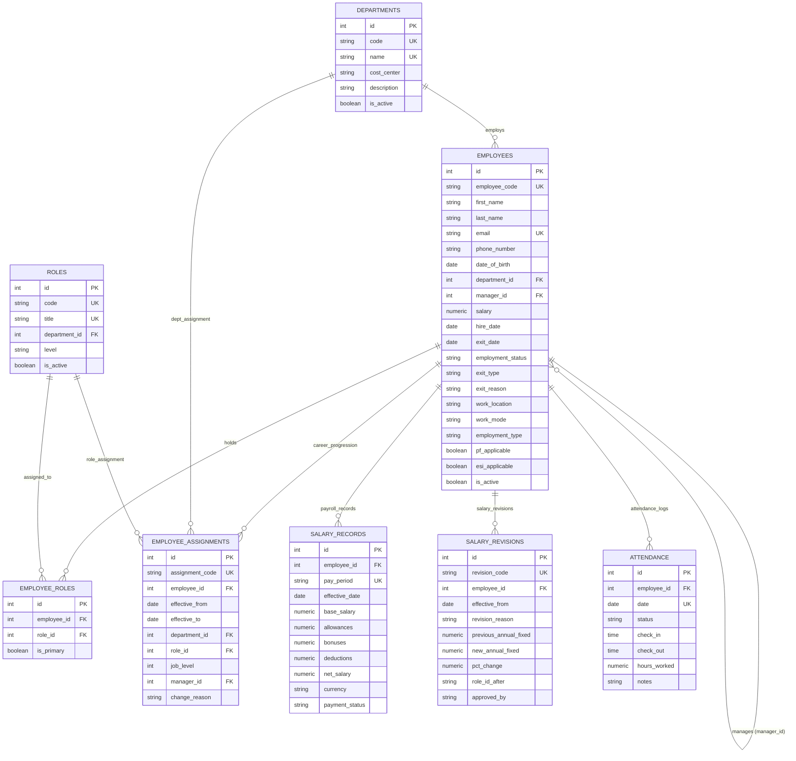

# Aura Workforce OS — Core Payroll, Accounting & Employee Data Engine
### Enterprise Workforce Management & Employee Data Engine (Python)

**GitHub Repository:** https://github.com/abhinav2231/employee-management-api-

A production-ready, layered **FastAPI** application backed by **PostgreSQL** in **Docker Compose**, with environment configuration via `pydantic-settings`, automated testing via `pytest`, and an early team handoff package for Aura Workforce OS.

---

## 🚀 Quickstart (One Command Starts Everything)

Ensure Docker Desktop is installed and running, then execute:

```bash
# 1. (Optional) Customize environment variables from the template:
cp .env.example .env

# 2. Build and launch database and API containers:
docker compose up --build -d
```

> **Note on `.env`:** The `docker-compose.yml` configures `required: false` for `.env`. All necessary configuration defaults are pre-baked, allowing a fresh clone to start up immediately without requiring manual `.env` file creation.

Both the PostgreSQL database (`db`) and FastAPI application (`api`) will start up:
- Database migrations (`alembic upgrade head`) execute automatically via `entrypoint.sh` before the API accepts traffic.
- Test database (`aura_workforce_test_db`) is automatically provisioned via Postgres init scripts and test fixtures.
- **API Server:** [http://localhost:8000](http://localhost:8000)
- **Interactive Swagger Docs:** [http://localhost:8000/docs](http://localhost:8000/docs)
- **ReDoc Documentation:** [http://localhost:8000/redoc](http://localhost:8000/redoc)
- **Health Check Endpoint:** [http://localhost:8000/health](http://localhost:8000/health)

To seed the initial master dataset:
```bash
docker compose exec api python -m scripts.seed
```

To run the automated test suite in Docker:
```bash
docker compose exec api pytest -v
```

To stop the services:
```bash
docker compose down
```

---

## 🏗️ Project Architecture (Layered Design)

This project strictly adheres to a layered design pattern to separate concerns cleanly:

```text
employee_management_api/
├── app/
│   ├── api/                     # Route controllers & routers
│   │   ├── v1/
│   │   │   ├── endpoints/
│   │   │   │   ├── health.py    # Health check route handler
│   │   │   │   ├── employees.py # Employee CRUD, search, filter & team routes
│   │   │   │   └── departments.py # Department listing and headcount routes
│   │   │   └── api.py           # v1 router aggregator
│   ├── core/                    # Core configuration and database session
│   │   ├── config.py            # Pydantic Settings loaded from .env
│   │   ├── database.py          # SQLAlchemy engine & session factory
│   │   └── exceptions.py        # Centralized error envelopes & handlers
│   ├── models/                  # SQLAlchemy ORM models
│   │   ├── base.py              # Base and TimestampMixin
│   │   ├── department.py        # Department entity
│   │   ├── role.py              # Role & EmployeeRole entities
│   │   ├── employee.py          # Employee entity with manager self-reference & attrition fields
│   │   ├── assignment.py        # EmployeeAssignment career history
│   │   ├── salary.py            # SalaryRecord compensation history
│   │   ├── salary_revision.py   # SalaryRevision compensation history
│   │   └── attendance.py        # Attendance tracking with explicit LOP & leave statuses
│   ├── schemas/                 # Pydantic request/response validation schemas
│   │   ├── common.py            # PaginatedResponse envelope
│   │   ├── health.py            # HealthResponse schema
│   │   ├── department.py        # Department schemas
│   │   ├── role.py              # Role schemas
│   │   └── employee.py          # Employee CRUD schemas
│   ├── services/                # Business logic layer
│   │   ├── health_service.py    # Health status logic
│   │   ├── department_service.py# Department business operations & aggregation
│   │   └── employee_service.py  # Employee operations, cycle prevention, inactive manager checks
│   └── main.py                  # FastAPI factory & app instance
├── data/
│   ├── 01_LedgerForge_Python_Master_Dataset.xlsx # Master dataset (Zenith Nova Technologies benchmark)
│   ├── sample_employees.json    # Modernized schema sample (10 realistic records)
│   ├── sample_employees.csv     # Modernized schema sample CSV
│   └── exports/                 # Standardized CSV exports
│       ├── employees.csv        # 745 employee records with en_IN numbers & attrition data
│       ├── salaries.csv         # 3,781 CY2026 payslip records
│       └── attendance.csv       # 36,751 attendance records with explicit loss-of-pay statuses
├── docs/
│   ├── api_contract.md          # Comprehensive early API contract
│   ├── er_diagram.md            # Data model and architectural decisions
│   └── openapi_draft.json       # Live OpenAPI 3.1 specification export
├── scripts/
│   ├── entrypoint.sh            # Container startup script (runs alembic upgrade head, eol=lf)
│   ├── data_pipeline.py         # Dataset extraction & pandas cleaning (NaN-safe leave parsing)
│   ├── seed.py                  # Master idempotent database seeder
│   ├── export_csv.py            # High-performance column-projected CSV export utility
│   ├── init_test_db.sql         # Postgres auto-init script for aura_workforce_test_db
│   └── view_data.py             # CLI database visualizer
├── tests/
│   ├── conftest.py              # Auto-provisioning test database runner (aura_workforce_test_db)
│   ├── test_health.py           # Health endpoint tests
│   ├── test_models.py           # Check constraints & relationship tests
│   ├── test_api_departments.py  # Department endpoint tests
│   ├── test_api_employees.py    # Employee CRUD, cycle prevention & inactive manager tests
│   └── test_seed_pipeline.py    # Seeding, idempotency, Faker repeatability & isolated exports
├── .env.example                 # Environment variables template (no secrets committed)
├── .gitattributes               # LF line endings enforcement for Docker portability
├── .gitignore                   # Standard gitignore (secrets, venv, caches)
├── Dockerfile                   # Python 3.12-slim container image definition
├── docker-compose.yml           # Compose setup with optional .env & test DB auto-init
├── pyproject.toml               # Modern Python project configuration
├── requirements.txt             # Locked project dependencies
└── README.md                    # Setup and execution guide
```

---

## 🗄️ Database Architecture & ER Diagram



### Architectural Decisions
1. **One-to-Many vs Multi-Role**: Employees hold multiple roles via `employee_roles` with an `is_primary` flag, allowing secondary duties without breaking schema migrations. If an employee's role changes in the master dataset, their primary role is updated in place.
2. **Organizational Hierarchy & Cycle Prevention**: Self-referential `manager_id` foreign key with acyclic hierarchy validation. Both direct self-management and multi-hop circular reporting (A → B → A, A → B → C → A) are prevented with a 400 Bad Request.
3. **Soft Deletes, Status & Exit Field Consistency**:
   - Status and exit fields maintain strict bidirectional consistency: deactivating an employee (`is_active = False` or soft delete) automatically sets `employment_status = "Deactivated"` (if not already set to an explicit exit status) and stamps `exit_date = date.today()` if not previously recorded, without inventing an exit type or reason (preventing soft-deletions from masquerading as voluntary resignations).
   - Re-activating an employee (`is_active = True`) automatically resets `employment_status = "Active"` and clears `exit_date`, `exit_type`, and `exit_reason`.
   - When a manager is soft-deleted, direct reports are automatically reparented to the manager's manager to eliminate orphaned hierarchy branches.
   - Assigning an inactive or soft-deleted employee as a manager is strictly rejected with a 400 Bad Request.
4. **Preservation of Career & Attrition History**:
   - `employee_assignments` stores 1,606 progression events (job level, department, role, manager changes).
   - `salary_revisions` stores 2,459 compensation adjustments and approvals.
   - `employment_status`, `exit_type`, and `exit_reason` preserve granular exit classifications (Resigned, Terminated, Contract Ended; Voluntary, Involuntary).
5. **Mid-Month Final Settlement Payroll Alignment**:
   - In CY2026, 35 employees departed mid-month (`period_start <= exit_date < period_end`). These records represent genuine final settlement payslips; their `effective_date` is strictly aligned to the employee's `exit_date` to ensure no compensation record is dated after an employee's departure.
6. **Loss-of-Pay & Leave Specificity**:
   - Attendance tracking preserves explicit loss-of-pay statuses: `ABSENT_LOP` and `HALF_DAY_UNPAID` alongside `PAID_LEAVE`, `UNPAID_LEAVE`, `REMOTE`, `PRESENT`, `HALF_DAY`, and `ABSENT`.
   - String missing-value conversion bug (`Leave Code: NAN`) is completely eliminated by pandas `pd.notna` pre-checks. `"Work From Home"` notes correctly populate on remote attendance logs.
7. **Isolated & Non-Destructive Test Execution**:
   - Pytest automatically provisions and manages an isolated database (`aura_workforce_test_db`) with strict guards preventing operations on non-test databases.
   - The master dataset is parsed once per test session via a session fixture, dramatically accelerating test execution.
   - CSV export tests operate in isolated temporary directories (`tmp_path`), guaranteeing test runs never overwrite repository CSV exports in `data/exports/`.
8. **Security, Privacy & Field Access Policy (Phase 1 vs Task 5)**:
   - In Phase 1 (Tasks 1–4), `GET /api/v1/employees` exposes core profile details, `employment_status`, `exit_type`, `exit_reason`, and `work_mode`.
   - Sensitive personal and statutory compliance fields (`date_of_birth`, `pf_applicable`, `esi_applicable`) along with internal progression tables (`salary_revisions`, `employee_assignments`) are persisted in PostgreSQL but deliberately withheld from public employee read endpoints until Task 5 introduces Role-Based Access Control (RBAC).

---

## 🧪 Running Tests & Verifying System

### Running Tests Locally

```bash
# Run full automated test suite (41 tests)
pytest -v
```

All 41 tests execute against the auto-provisioned isolated test database:
```text
======================= 41 passed in ~25s =======================
```

### Proving End-to-End Operation (Docker)

```bash
# 1. Start containers (auto-applies migrations and provisions test DB)
docker compose up --build -d

# 2. Check health endpoint
curl http://localhost:8000/health
# Output: {"status":"ok"}

# 3. Test migration rollbacks and re-application
docker compose exec api alembic downgrade base
docker compose exec api alembic upgrade head
docker compose exec api alembic check

# 4. Run master dataset seeder
docker compose exec api python -m scripts.seed

# 5. Verify idempotent seeding (row counts remain unchanged)
docker compose exec api python -m scripts.seed

# 6. Run automated test suite inside Docker
docker compose exec api pytest -v
```

---

## 📊 Dataset Provenance & Clean Exports

- **Source File:** [`data/01_LedgerForge_Python_Master_Dataset.xlsx`](data/01_LedgerForge_Python_Master_Dataset.xlsx)
- **Provenance & Benchmarking Origin:**
  - **Dataset Title:** *LedgerForge Master Dataset: Section 1 — Python: Core Payroll, Accounting & Employee Data Engine*.
  - **Simulated Entity:** Zenith Nova Technologies Pvt Ltd (mid-size Indian technology company, cut-off date September 30, 2026).
  - **Source:** Fictional training dataset provided by the program (company "Zenith Nova Technologies", as stated in the workbook's README sheet). All people, clients and numbers are fictional.
  - **License:** The workbook does not state a license. No Kaggle HR dataset was used; the provided master dataset replaces it.
- **Headline Numbers & Verified Schema Metrics:**
  - **Employees Ever Employed:** Exactly 745 employees (441 active, 304 exited).
  - **Departments & Roles:** 11 departments and 58 distinct roles spanning 7 job levels.
  - **Career Progression History:** 1,606 career assignment milestones (`employee_assignments`).
  - **Salary Revisions:** 2,459 historical compensation adjustments (`salary_revisions`).
  - **Operational Payroll Window:** Pinned to **CY 2026** (2026-01-01 to 2026-09-01, exactly 9 calendar months), capturing **3,781 active payslip records**. Includes 35 mid-month final settlement records aligned to employee exit dates.
  - **Attendance Window:** 4-month operational window (May 30 to Sep 30, 2026) capturing **36,751 attendance records** with clean leave codes and explicit `ABSENT_LOP` / `HALF_DAY_UNPAID` loss-of-pay statuses.
  - **Phone Numbers:** Generated with Faker (seed 42), format +91[6-9]XXXXXXXXX (text formatted).
- **Standardized CSV Exports in [`data/exports/`](data/exports/):**
  - [`employees.csv`](data/exports/employees.csv): 745 employee records with `employee_code`, `first_name`, `last_name`, `email`, `phone_number`, `department_code`, `department_name`, `role_title`, `manager_code`, `manager_name`, `salary`, `hire_date`, `exit_date`, `work_location`, `work_mode`, `employment_type`, `employment_status`, `exit_type`, `exit_reason`, and `is_active`.
  - [`salaries.csv`](data/exports/salaries.csv): 3,781 monthly payslip records with `employee_code`, `first_name`, `last_name`, `pay_period`, `effective_date`, `base_salary`, `allowances`, `bonuses`, `deductions`, `net_salary`, `currency`, and `payment_status`.
  - [`attendance.csv`](data/exports/attendance.csv): 36,751 attendance records with `employee_code`, `date`, `status`, `check_in`, `check_out`, `hours_worked`, and `notes`.

---

## 🔗 Connection to Next Task (Task 5)

With clean master dataset seeding, career history preservation, acyclic manager hierarchy enforcement, isolated testing, and non-destructive CSV exports established, **Task 5 (Authentication & Role-Based Access Control)** will introduce JWT authentication tokens, role-based field masking, and audit logging for compensation and management changes.
