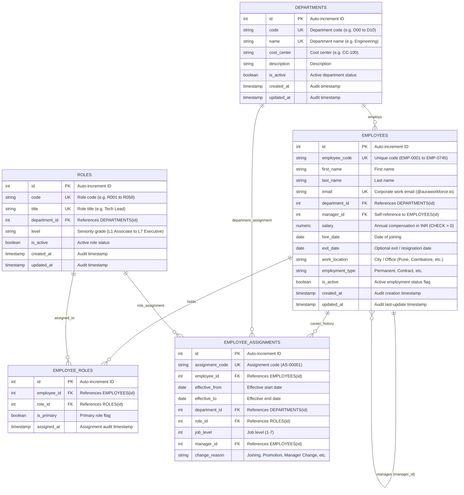

# Aura Workforce OS — Entity Relationship (ER) Data Model

## 1. Overview
The **Aura Workforce OS** data model provides the normalized relational foundation for workforce records, organization hierarchy, multi-role assignments, compensation records, daily attendance tracking, and career progression history.

---

## 2. Mermaid Entity Relationship Diagram

---

## 3. Architectural Design Decisions

### 3.1 Role Cardinality Decision: One Role vs Many Roles
- **Decision:** Employees can hold **multiple roles** through the `employee_roles` association entity, with an `is_primary` flag.
- **Rationale:** 
  1. In modern organizations, employees have a single primary contractual position (e.g., *Senior Software Engineer*) used for salary bands and payroll.
  2. However, team members often take on functional, operational, or governance responsibilities (e.g., *Hiring Bar Raiser*, *Incident Commander*, *Team Lead*).
  3. Storing roles in a junction table (`employee_roles`) ensures zero breaking database migrations when secondary duties or future security permissions are added.

### 3.2 Organizational Hierarchy (Self-Referential Manager Relationship)
- `manager_id` is a nullable foreign key pointing to `employees.id` with `ON DELETE SET NULL`.
- Top-level leadership (e.g. CEO) has `manager_id = NULL`.
- An employee's direct reports can be loaded via `employee.direct_reports` while the reporting line is accessed via `employee.manager`.

### 3.3 Soft Delete Pattern (`is_active`)
- Deleting an employee physically destroys historical audit trails for payroll, attendance, and compliance.
- Records are preserved permanently; soft deletion toggles `is_active = FALSE`.

### 3.4 Constraints and Performance Indexes
- **Unique Constraints:**
  - `employees.email`: Enforces strict corporate email uniqueness.
  - `departments.name` & `departments.code`: Prevents duplicate departments.
  - `roles.title`: Prevents ambiguous duplicate job definitions.
  - `employee_roles(employee_id, role_id)`: Prevents assigning the same role twice to one person.
- **Check Constraints:**
  - `ck_employees_salary_positive`: Guarantees `salary > 0`.
- **Performance Indexes:**
  - `ix_employees_email`: Instant authentication and search lookups.
  - `ix_employees_name (last_name, first_name)`: Composite index for alphabetized roster queries.
  - `ix_employees_department_id`: Speeds up department employee listings.
  - `ix_employees_manager_id`: Fast manager-tree and direct-report traversals.
  - `ix_employees_is_active`: Efficient filtering of currently active workforce.
